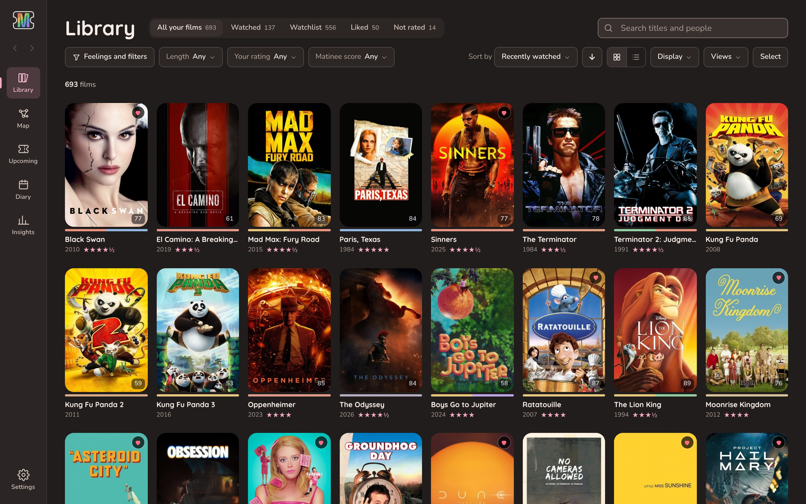
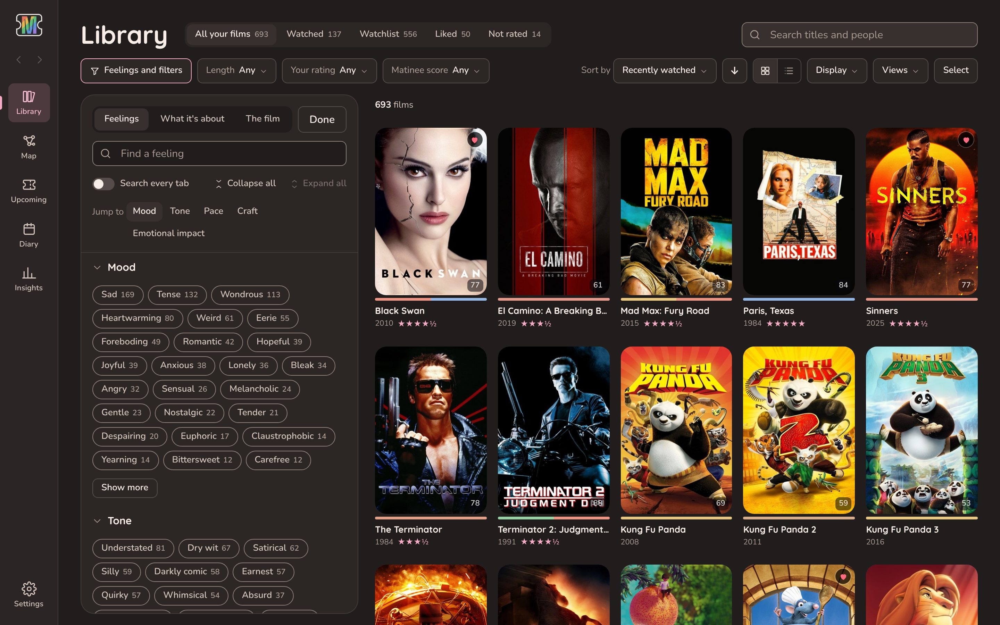
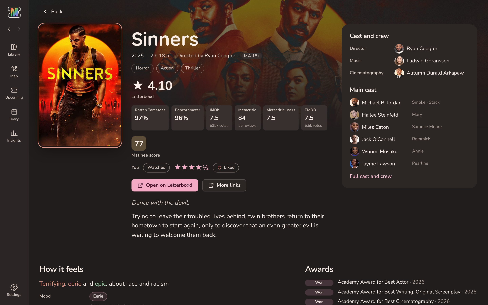
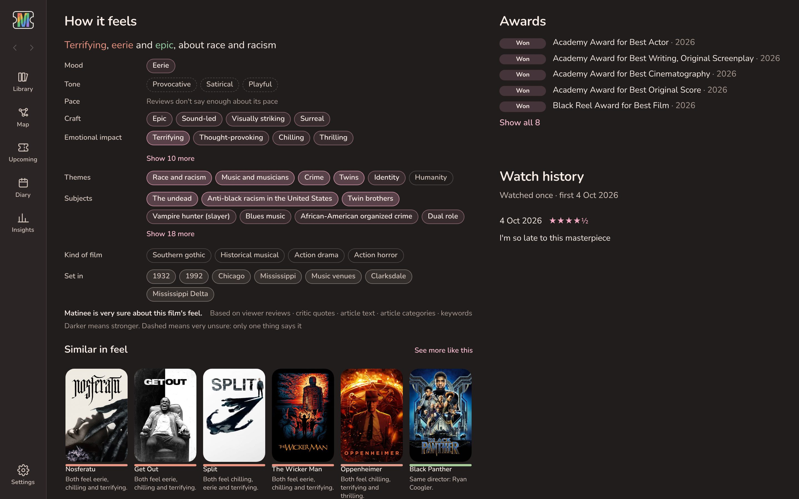
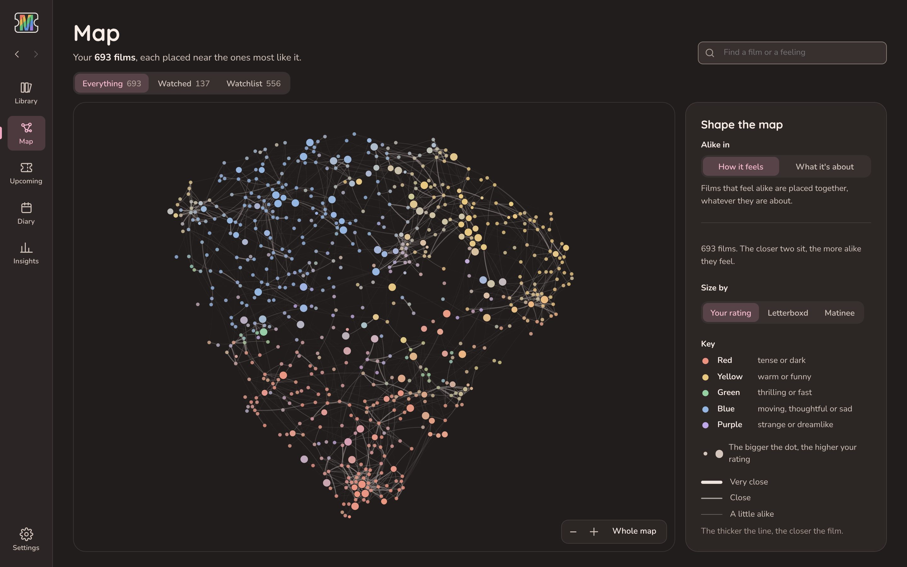
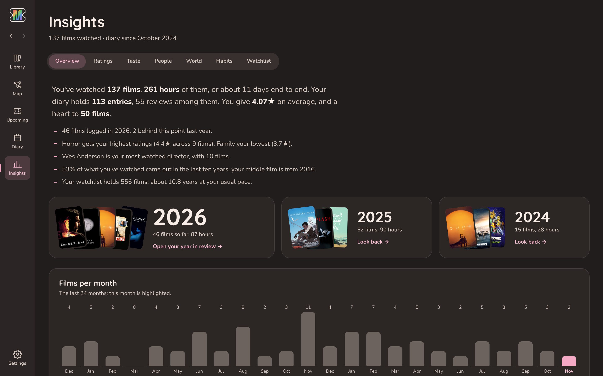

# Matinee

> [!CAUTION]
> **On a Mac, Matinee won't open the first time.** It isn't signed by Apple, so macOS blocks it. To open it:
>
> 1. **Drag Matinee into Applications, then open it once.** macOS says it can't check it for malicious software. Click **Done**.
> 2. **Open System Settings → Privacy & Security**, scroll down and click **Open Anyway** next to Matinee.
> 3. **Open Matinee again** and click **Open Anyway** when asked.
>
> **If macOS says Matinee is "damaged"**, open Terminal and run `xattr -cr /Applications/Matinee.app`, then open it again.
> Right-click → Open no longer works for this on macOS 15 and later.

> [!NOTE]
> **Matinee is vibe-coded.** I designed it and made the decisions about what it does and how it looks; the code itself
> was written with AI.

A desktop companion for your Letterboxd account. Matinee reads your Letterboxd export and turns it into a bigger film
library: ratings from every major site side by side, what each film feels like, a map of how your films relate, and
stats on what you watch.

It never changes anything on Letterboxd. Log and rate there as usual; Matinee reads it. Everything stays on your
computer, with no account or sign-up.

For Windows, Mac and Linux.



## What it does

### Your library, by feel

Every film you've watched or saved, as a poster wall or a list. Filter by how a film feels (tense, wondrous,
heartwarming), what it's about, where it's set, its length, your rating and more. Click a feeling once to look for it,
twice to leave it out.



### Film pages

Every score in one place: Letterboxd, Rotten Tomatoes, Popcornmeter, IMDb, Metacritic, TMDB, and a blended Matinee
score. Plus the cast and crew, awards, your own diary entries and reviews.



### How it feels

Matinee reads viewer reviews, critic quotes and articles about each film and sums up its mood, tone, pace, craft,
emotional impact and themes. Darker chips are stronger. It says how sure it is, and when there isn't enough written about
a film it tells you instead of guessing. "Similar in feel" finds films in your library that feel the same way.



### Map

All your films on one board, each placed near the ones most like it, coloured by feel. Drag, zoom, search for a film or
a feeling, and click a film to see its closest matches.



### Insights and Year in review

What you watch, when and how you rate it: your taste in feelings, the people you return to, countries, habits and your
watchlist. Each year gets its own look back, with a card you can save.



Also: a diary of everything you've logged, person pages for directors and actors, and upcoming releases in your
country.

## Install

Download the file for your computer from the [Releases page](https://github.com/defmellow/matinee-app/releases/latest).

| Computer | File |
|---|---|
| Windows | `Matinee-<version>-Windows.exe` (installer) or `Matinee-<version>-Windows-Portable.exe` (no install) |
| Mac with Apple Silicon (M1 and later) | `Matinee-<version>-Mac.dmg` |
| Mac with an Intel chip | `Matinee-<version>-Mac-Intel.dmg` |
| Linux | `Matinee-<version>-Linux.AppImage` or `Matinee-<version>-Linux.deb` |

- **Windows:** you'll see "Windows protected your PC" because the app isn't signed. Click **More info**, then **Run anyway**.
- **Mac:** see the steps at the top of this page.
- **Linux:** make the AppImage executable (`chmod +x Matinee-*-Linux.AppImage`) and run it, or install the .deb with
  `sudo apt install ./Matinee-*-Linux.deb`.

The Windows installer and the AppImage update themselves. The other versions tell you when there's a new one to download.

## Getting started

1. On Letterboxd, go to **Settings → Data → Export your data** ([letterboxd.com/settings/data](https://letterboxd.com/settings/data/)).
   You'll get a ZIP file. (Safari on a Mac unzips it into a folder; that works too.)
2. Open Matinee and drop the ZIP or folder onto the welcome screen.

Your films show straight away. Matinee then fills in posters, ratings and details in the background; the first time takes
a few minutes for a big library. After that it picks up new diary entries from your public Letterboxd feed each time it
opens. Drop in a newer export from **Settings** any time to bring everything else up to date.

### Optional: free API keys

Matinee works without any setup. In **Settings → Sources** you can add free keys for faster, fuller details:

- **TMDB**: posters, backdrops, full cast lists and keywords.
- **OMDb**: extra ratings for films other sources miss.

Settings explains how to get each one.

## Where the data comes from

Film details from [Wikidata](https://www.wikidata.org) and [Wikipedia](https://en.wikipedia.org), IMDb ratings from IMDb's
public datasets, and scores and reviews from public film pages (Letterboxd, Rotten Tomatoes, Metacritic, IMDb, AllMovie).
Optional: TMDB and OMDb. This product uses the TMDB API but is not endorsed or certified by TMDB.

Matinee is not affiliated with Letterboxd, IMDb, Rotten Tomatoes, Metacritic, TMDB or OMDb.

## Building from source

Needs Node 22.

```
npm install
npm test            # unit tests
npm run dev         # the interface in a browser, at http://localhost:5317
npm start           # build and run the desktop app
```

Installers for all three systems are made by the **Build installers** GitHub Actions workflow.

## Licence

[GPL-3.0-or-later](LICENSE).
